# Quantum Zeeman Engine

[](https://github.com/klinng/Quantum-Zeeman-Engine/actions/workflows/latex.yml)


**Take one big physics problem, split it into levels, and make every level checkable:**
a LaTeX derivation, a Python model, a plot or animation, and a comparison with measured values.
If the computed number reproduces the experiment, the model underneath is correct.

The first case study is the **Zeeman effect** (how a magnetic field splits atomic energy levels).
It grew from four levels of theory into a small lab: sodium and hydrogen, real spectra,
a virtual spectrometer with colours, a prism and polarisation filters, and seven notebooks.

<p align="center">
  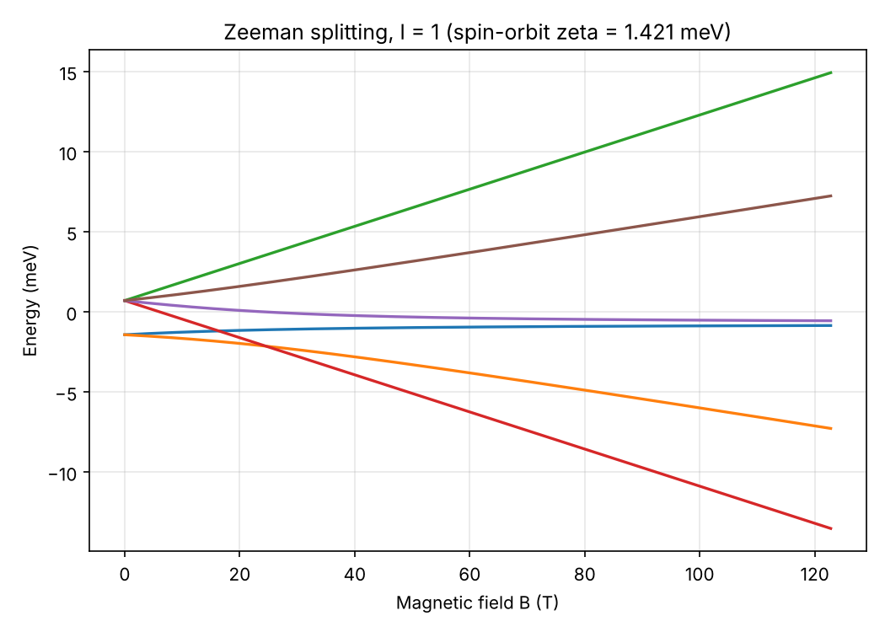
</p>

## Quick start

```bash
git clone https://github.com/klinng/Quantum-Zeeman-Engine.git
cd Quantum-Zeeman-Engine
pip install -r requirements.txt
python scripts/run_all.py --fast     # tests, figures, notebooks, PDF (drop --fast to also render the GIFs)
python -m pytest -q                  # 135 tests
```

Or only what you need: `python scripts/make_figures.py --gif`, `python scripts/make_optics_figures.py --gif`,
`python scripts/execute_notebooks.py`, `cd docs && latexmk -pdf main.tex`.

## What works for which atom

| System | Energy levels vs B | Line spectrum | Polarisation filters | Prism / instruments | Notebook | Report section |
|---|:-:|:-:|:-:|:-:|:-:|---|
| **Sodium** (3p to 3s, D lines) | yes | yes | yes | yes | 1 to 4, 6 | Levels 1 to 4, Extension B |
| **Hydrogen n = 2** (Lamb shift, 2s and 2p) | yes, with crossings; with an electric field, anticrossings and quenching | no (no jump between 2s and 2p) | no | no | 5 | Extension A |
| **Hydrogen H-alpha** (n = 3 to 2, 656 nm) | yes | yes | yes | yes | 7 | Extension C |
| **Calcium 4s4p** (two electrons: singlet and triplet P terms) | yes | not yet | not yet | not yet | none yet | Extension E |

A spectrum needs a jump between two shells. That is why hydrogen n = 2 alone has levels but no light, and why H-alpha was added.

## Gallery

<p align="center">
  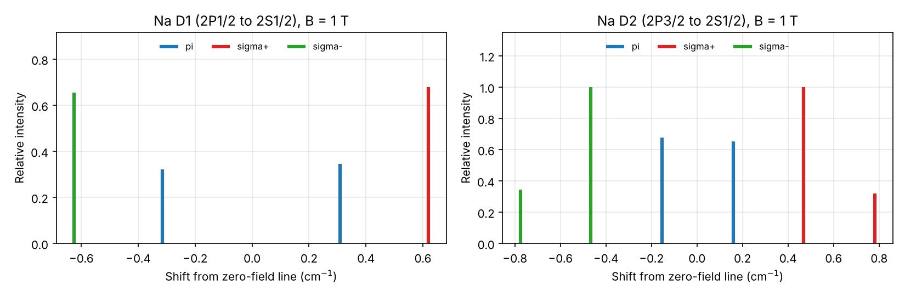
</p>

*Sodium D lines at 1 T: 4 components for D1, 6 for D2, with polarisation (colour) and relative intensity (height).
Everything comes from diagonalising the Hamiltonian and applying the dipole operator.*

<p align="center">
  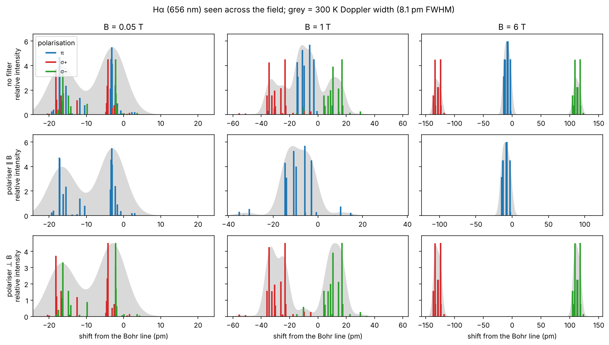
</p>

*Hydrogen H-alpha at 0.05, 1 and 6 T. Rows: no filter, polariser parallel to B (keeps pi), polariser perpendicular to B (keeps sigma).
Grey is the 300 K Doppler width (8.1 pm). At 6 T the line has become the normal three-group Zeeman pattern.*

<p align="center">
  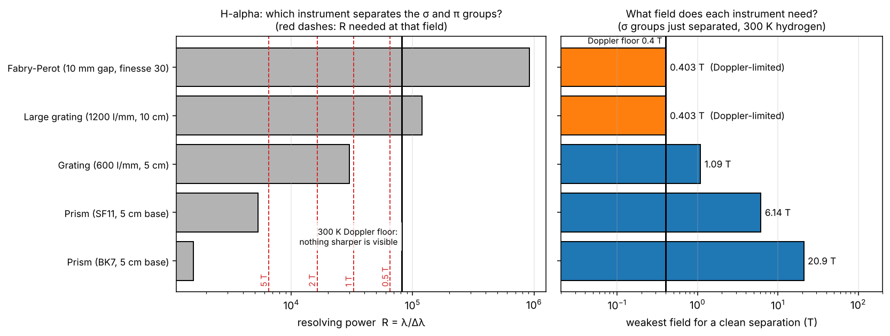
</p>

*Which instrument can separate the H-alpha groups? A 5 cm glass prism needs 6 to 21 T, a 10 cm grating about 0.4 T. For hydrogen, thermal motion
(8.1 pm at 300 K) blurs the line so much that a Fabry-Perot gains nothing over the big grating: the Doppler floor is the limit, not the instrument.*

<p align="center">
  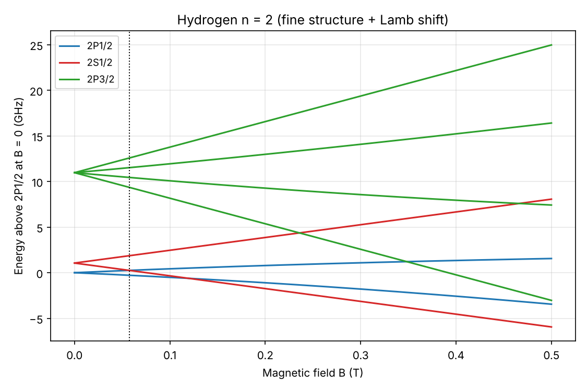
</p>

*Hydrogen n = 2. The dotted line is the predicted 2S1/2 / 2P1/2 crossing at 573 G. A magnetic field never mixes 2s with 2p, so these levels cross instead of repelling.*

<p align="center">
  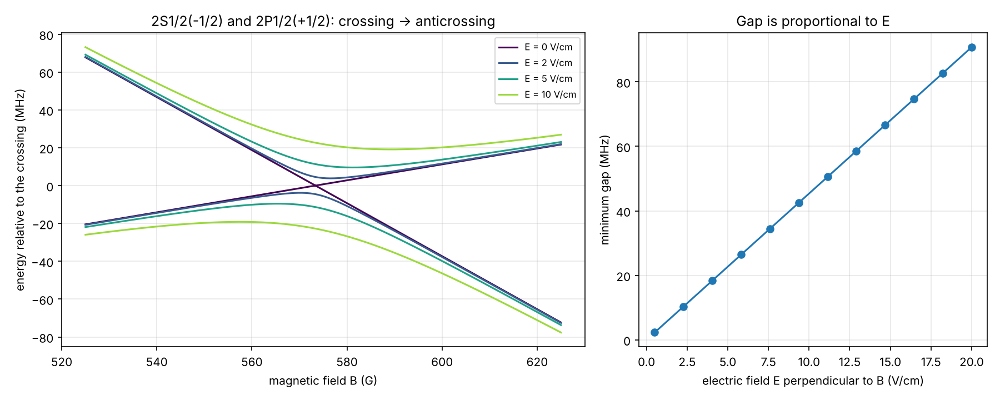
</p>

*Electric field on hydrogen n = 2. Across B, the 573 G crossing opens into an anticrossing whose gap grows in proportion to E (the Lamb-Retherford effect).
Along B, 2S and 2P with the same m_j repel, and the metastable 2S state is quenched from 0.12 s towards nanoseconds (figure `hydrogen_stark_fan.png`).*

### The virtual spectrometer: colours, a prism, polarisation filters

<p align="center">
  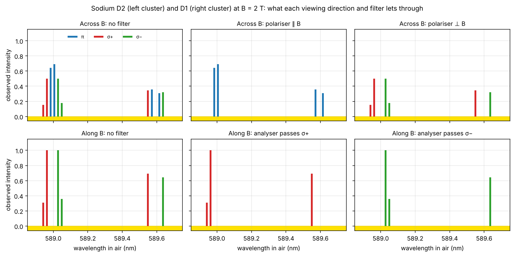
</p>

*Sodium D lines at 2 T. Across the field a polariser parallel to B keeps only the pi lines and a perpendicular one keeps only sigma.
Along the field there is no pi light, and a circular analyser separates sigma+ (red) from sigma- (green).*

| Animation | What it shows |
|---|---|
| 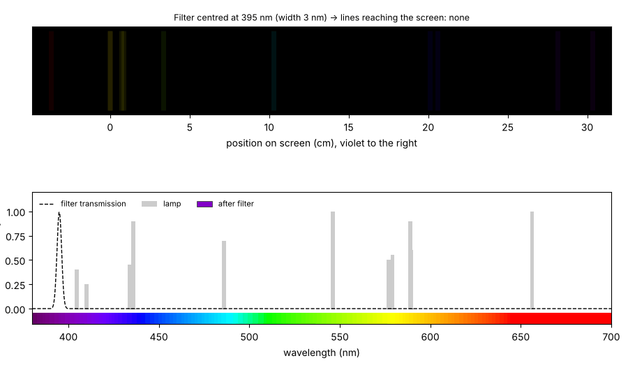 | **Colour filter sweeping the spectrum**: only the lamp lines inside the pass band reach the prism screen |
| 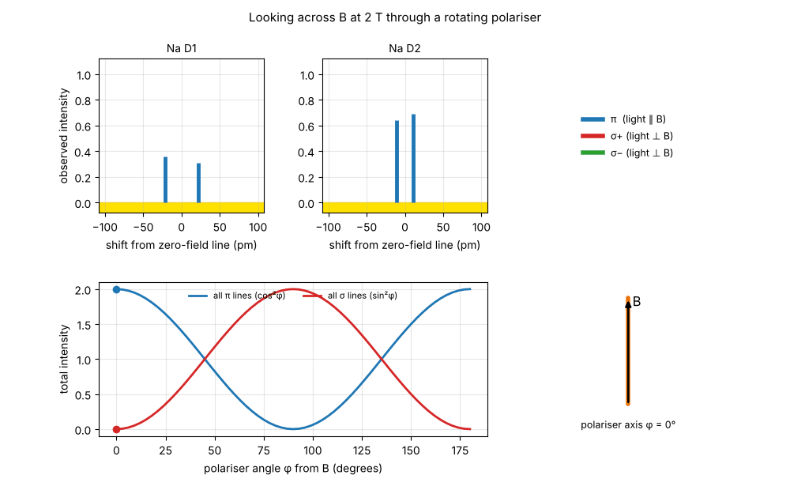 | **Rotating polariser** (Malus's law): pi and sigma lines trade places |
| 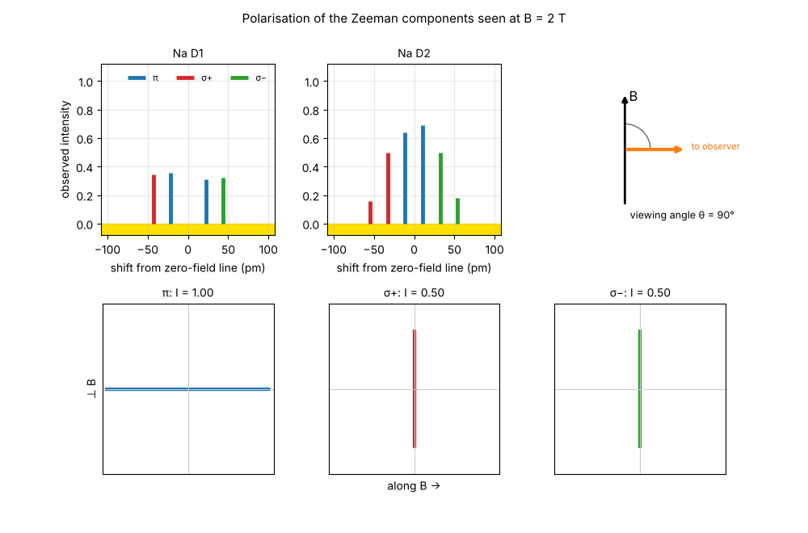 | **Tilting the line of sight**: pi fades out, sigma becomes circular |
| 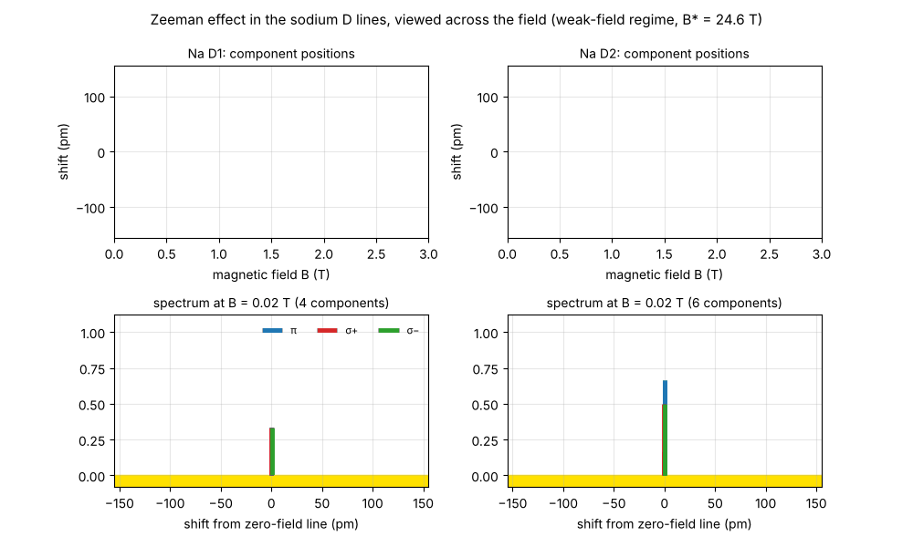 | **Field ramp**: the Zeeman components of Na D1 and D2 fan out |
| 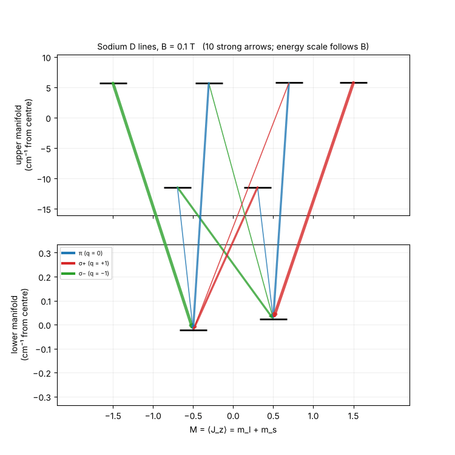 | **Level diagram with arrows** (Grotrian): one arrow per allowed transition, colour = polarisation, width = intensity; spin-flip arrows fade as B grows to 60 T |
| 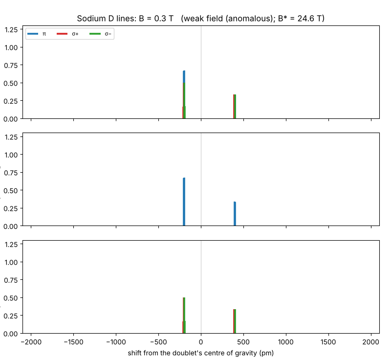 | **Sodium D lines up to 60 T**: two anomalous patterns collapse towards the normal Zeeman triplet (above B* = 24.6 T the field beats spin-orbit coupling) |
| 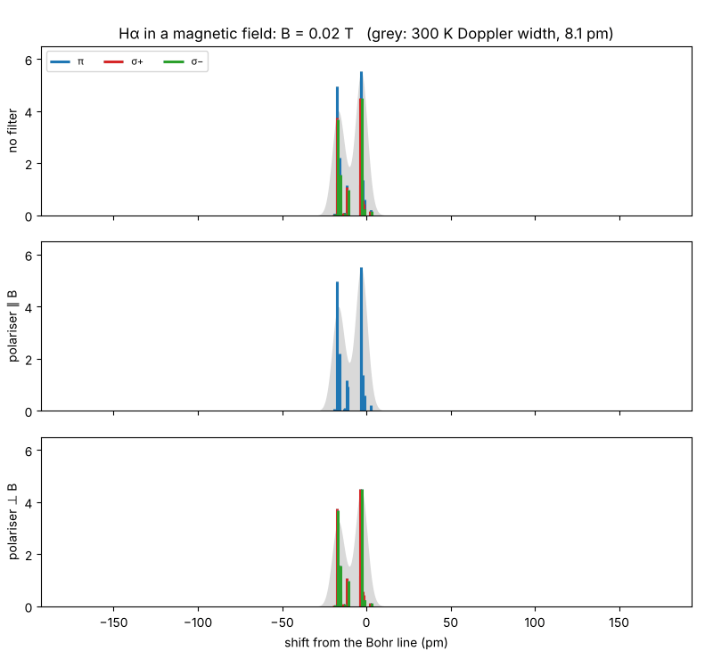 | **Hydrogen H-alpha field ramp**: through no filter, a parallel and a perpendicular polariser, from weak field to Paschen-Back |

<p align="center">
  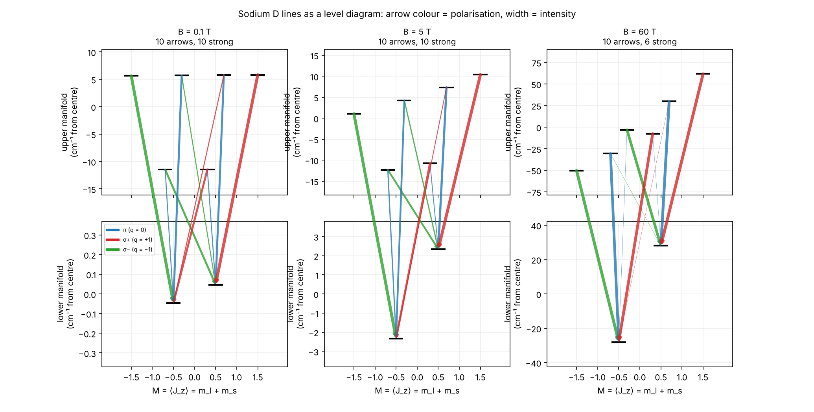
</p>

*The same lines drawn as a level diagram. Levels sit at M = m_l + m_s (always conserved), arrows exist only where the transition is allowed, and at 60 T only 6 of the 10 arrows stay strong.*

**An honest scale note.** The outermost sodium D2 component moves only about 27 pm per tesla, and every component is the same yellow.
A prism cannot separate them: the closest components need a resolving power of about 55 000 at 1 T, while a 5 cm glass prism offers about 2 000.

<p align="center">
  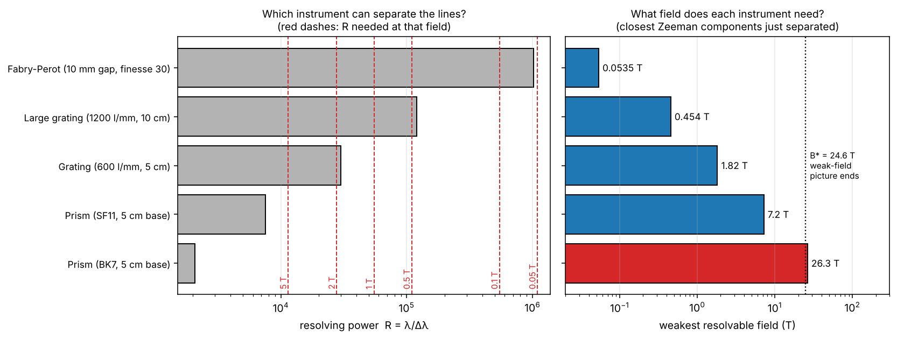
</p>

**The instrument that can.** A Fabry-Perot etalon (5 mm gap, finesse 30) turns each wavelength into a ring. At 0.3 T the sodium D2 ring splits
into six: two pi (blue) and four sigma (red and green), with peak heights close to the classic 4 : 3 : 1. A perpendicular polariser removes the pi pair.

<p align="center">
  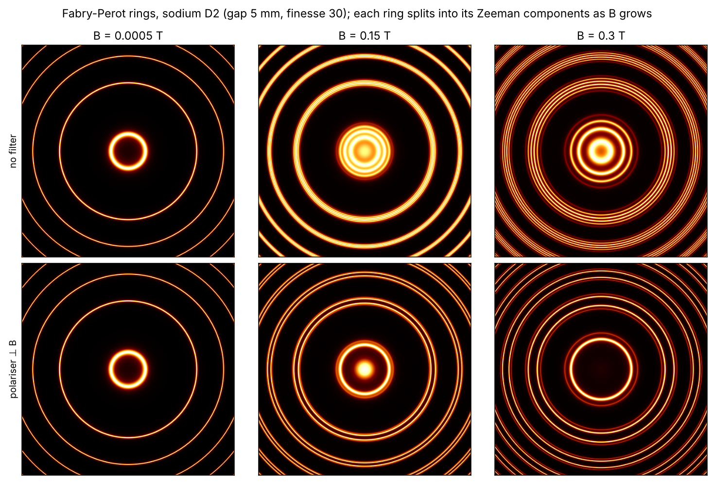
</p>
<p align="center">
  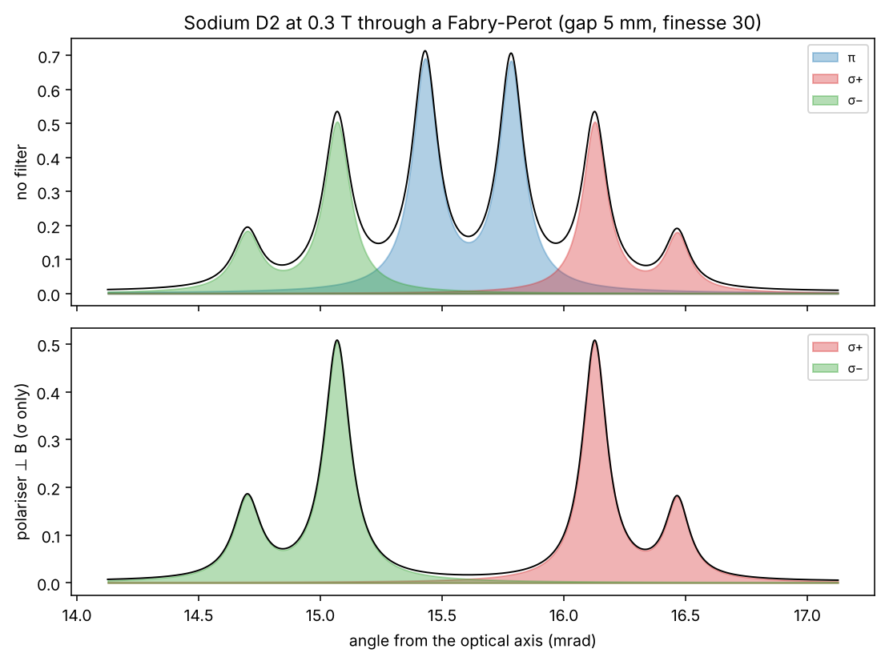
</p>

**Strong field.** Above B* = ζ/μ_B ≈ 24.6 T the field overpowers the spin-orbit coupling and the sodium D doublet collapses towards the normal Zeeman
triplet. D1 and D2 lines cross over, so shifts are measured from the doublet's centre of gravity. A built-in check: the intensity-weighted mean σ shift is
±16.2 pm/T at every field from 1 to 120 T, whatever the pattern looks like.

<p align="center">
  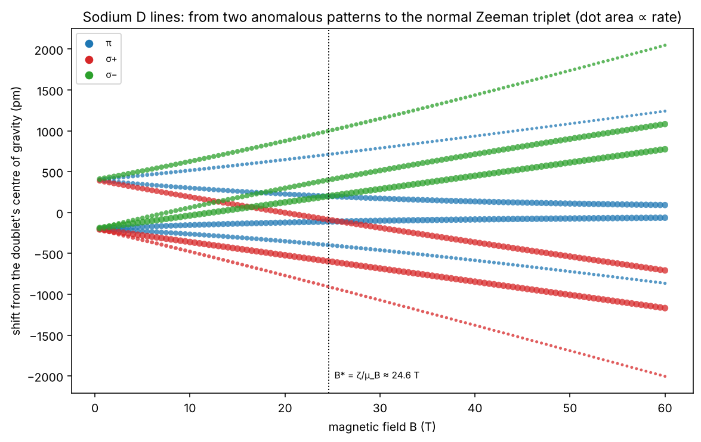
</p>

**Checked against a published calculation.** At 0.9 T the five sodium line-group spacings of the model agree with those of arXiv:2104.14896
(a theory study that includes hyperfine structure) to within 0.5 %. That is agreement with another calculation, not with laboratory data.

<p align="center">
  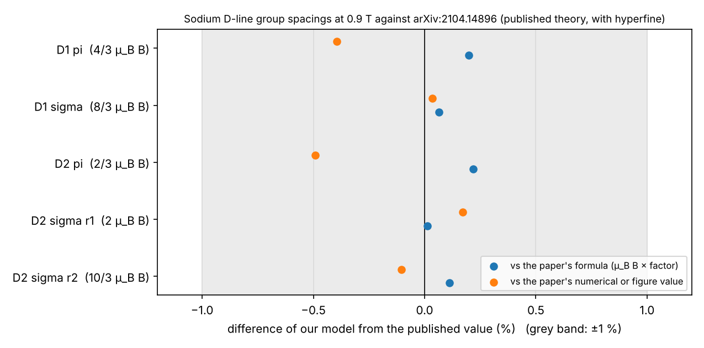
</p>

## Why decompose a problem?

1. **Understand** the phenomenon, the math and the physics behind it, one layer at a time.
2. **Verify** each layer against known results before adding the next, so errors can't hide.
3. **Compute, plot, animate** and run numerical experiments on a model you trust.

## The levels and extensions

| Part | Physics | Key result | Code | Report |
|---|---|---|---|---|
| Level 1 | Normal Zeeman (orbital only) | ΔE = μ_B B m_l, Lorentz triplet | `hamiltonians.h_zeeman` | `level_1_normal.tex` |
| Level 2 | Spin-orbit coupling, Landé g | ΔE = g_J μ_B B m_j | `hamiltonians.landé_g`, `h_spin_orbit` | `level_2_anomalous.tex` |
| Level 3 | Paschen-Back (strong field) | E ≈ μ_B B (m_l + g_s m_s) + ζ m_l m_s | `solvers.track_levels` | `level_3_paschen_back.tex` |
| Level 4 | Wigner-Eckart, selection rules, intensities, fitting | full line spectrum with polarisation | `transitions.py`, `fitting.py` | `level_4_tensors.tex` |
| Extension A | Hydrogen n = 2: Lamb shift, 2S-2P crossing | 573 G, against "about 570 G" in the literature | `hydrogen.py` | `ext_hydrogen_n2.tex` |
| Extension B | Colours, prism, polarisation filters, instrument ladder | four animations, required resolving power | `src/optics/` | `ext_optics.tex` |
| Extension E | Two valence electrons (calcium 4s4p): exchange splitting, spin-orbit mixing of singlet and triplet | Landé interval rule to 0.09 cm⁻¹; singlet admixture 7.8e-5 | `two_electron.py` | `ext_two_electron.tex` |
| Extension D | Electric field on hydrogen n = 2: Stark mixing, Lamb-Retherford anticrossing, 2S quenching | gap = 2√3 e a₀ E at 573 G | `stark.py` | `ext_hydrogen_stark.tex` |
| Extension F | Nuclear spin: hyperfine structure of sodium and hydrogen n = 2, and the sodium D lines with hyperfine (6 D2 lines, 4 D1 lines); the 573 G crossing splits into four | Na 3S splitting 1771.626 MHz; mean crossing 571.6 G | `hyperfine.py` | `ext_hyperfine.tex` |
| Extension I | Photon operators a, a† and the Jaynes-Cummings atom-in-a-cavity demo | vacuum Rabi cos²(g t) and splitting g√N reproduced exactly | `cavity.py` | `ext_cavity.tex` |
| Extension G | Uncertainty: Monte Carlo and derivative propagation, z-score comparison, and a global budget table covering sodium, hydrogen n = 2, H-alpha and calcium | sampled σ equals exact σ (Na 3P₁/₂: 0.26 MHz); g_J(3S₁/₂) differs from measurement by 2.3e-5 (free-electron g_s) | `uncertainty.py`, `budget.py` | `ext_uncertainty.tex` |
| Extension H | Line shapes: Doppler, natural and pressure widths as Voigt profiles; sodium D2 resolved only when cold | Na D2 natural width 9.80 MHz (from NIST A) | `line_profiles.py` | `ext_voigt.tex` |
| Extension C | Hydrogen H-alpha (n = 3 to 2) with radial integrals, Dirac fine structure | spectrum from weak field to Paschen-Back | `hydrogen_spectrum.py` | `ext_hydrogen_halpha.tex` |

Every part has a test file; notebooks 1 to 7 show the same ideas with explanations and saved output.

## The model

For one electron with orbital momentum $l$ and spin $1/2$:

$$H = H_0 + \zeta\,\mathbf{L}\cdot\mathbf{S} + \mu_B B\,(g_l L_z + g_s S_z)$$

It is built as a matrix in the basis $|l, m_l\rangle \otimes |\tfrac12, m_s\rangle$ and diagonalised with `numpy.linalg.eigh`.
For sodium, ζ is fixed once from the measured 3p fine-structure splitting (17.196 cm⁻¹); everything else is a prediction.
Transition intensities use the Wigner-Eckart theorem: dipole matrix elements are 3-j symbols projected onto the exact eigenvectors.
For hydrogen, each shell is block-diagonal in $l$, Dirac energies fix the fine structure, and the radial dipole integrals come from the wavefunctions.

## Results (all reproduced by the test suite)

### Sodium

| Quantity | Model | Reference | Note |
|---|---|---|---|
| 3p fine-structure splitting | 17.196 cm⁻¹ | 17.196 cm⁻¹ | input, used to set ζ |
| g_J (²P₁/₂) | 0.6659 | 2/3 = 0.6667 | difference is g_s = 2.0023 instead of 2 |
| g_J (²P₃/₂) | 1.3341 | 4/3 = 1.3333 | same reason |
| g_J (²P₁/₂), (²P₃/₂) vs measured | 0.66589, 1.33411 | 0.66581(12), 1.3342(2) | within 1σ; values from Steck's Sodium D Line Data (check the PDF) |
| g_J (²S₁/₂) vs measured | 2.0023193 | 2.0022960(7) | model lacks the bound-state correction (2.3e-5); a known limit |
| D1 / D2 Zeeman components | 4 / 6 | 4 / 6 | textbook pattern |
| D2 : D1 intensity ratio | 2.000 | 2 | statistical weights 4 : 2 |
| D1 components across B | 4 equal | 4 equal | classic result |
| D2 components across B (pi : inner sigma : outer sigma) | 4.00 : 2.99 : 1.00 | 4 : 3 : 1 | classic result |
| ζ recovered from synthetic data (1 µeV noise) | about 0.01 % error | known input | `fitting.py`, notebook 4 |
| D1 / D2 group spacings at 0.9 T (5 groups) | within 0.5 % | arXiv:2104.14896 (published theory, includes hyperfine) | `literature.py`; agreement with another calculation, not laboratory data |
| Ca 4s4p ³P₁ lifetime (intercombination line, 657 nm) | 0.22 ms | 0.39 ms (410 Hz) and 0.42 ms (375 Hz) in two papers | order of magnitude only (factor 1.8 to 1.9); ¹P₁ rate 2.20e8 from the NIST Handbook |
| Ca 4s4p ³P₁ energy | 15210.0638 cm⁻¹ (used as input) | 455 986 240 494 135.8 Hz measured, divided by c | verified from [a frequency measurement](https://tf.nist.gov/general/pdf/2197.pdf) |
| Ca 4s4p Landé interval rule (³P₂−³P₁ : ³P₁−³P₀) | holds to 0.09 cm⁻¹ | 2 : 1 | term energies from the NIST Handbook (see Sources) |
| Resolving power to separate components at 1 T | about 55 000 | prism 2 000, grating 1.2×10⁵ | a prism cannot show the pattern |

### Hydrogen

| Quantity | Model | Reference | Note |
|---|---|---|---|
| 2S × 2P crossing near 573 G, no hyperfine | 573.4 G | "about 570 G" (Westig et al., arXiv:1104.4421, introduction) | single crossing |
| Same crossing with proton hyperfine | four crossings at 538.1, 552.2, 591.0, 605.0 G; mean 571.6 G | spin-filter fields quoted in the same paper (Fig. 2 caption): 535 G and 605 G for H-alpha | 605 G matches; the lower one differs by 3 G (535 against 538.1), which I cannot explain from the abstract and caption alone (the quoted fields are selection settings, possibly rounded); the mean is close to "about 570 G" |
| H 2P₁/₂ hyperfine splitting | 59.2212 MHz (input) | theory 59221.2 kHz and measured 60(2) MHz, same paper | the measurement is too coarse to test the model; Lamb shift there 1057(1) MHz agrees with the value used |
| H 2S hyperfine splitting | 177.55686 MHz | 177.556860(16) MHz, measured (arXiv:physics/0608192) | an input, not a prediction |
| Na 3S₁/₂ hyperfine splitting | 1771.6261 MHz | Steck table | an input (A), reproduced as 2A |
| Na D2 hyperfine line strengths | 1/20, 1/4, 7/10 (F=2) and 1/6, 5/12, 5/12 (F=1) | standard angular-momentum (Racah) values | not an input: the model produces them from the dipole matrices |
| 2P₃/₂ − 2P₁/₂ (Dirac vs measured) | 10949 MHz | 10969.13(10) MHz (Baird et al. 1972) | 0.2 % apart (QED) |
| ⟨2p\|r\|1s⟩ | 1.290266 a₀ | 128√6/243 a₀ | exact |
| A(2p to 1s), A(3p to 2s), A(3d to 2p) | 6.258e8, 2.242e7, 6.458e7 s⁻¹ | 6.265e8, 2.245e7, 6.465e7 s⁻¹ | about 0.1 %; reference values from Wiese and Fuhr 2009, Table 6 |
| H-alpha sigma shift at 20 T | 402.27 pm | 20.11 pm/T × B = 402.20 pm | normal Zeeman limit |
| 2S Stark shift at 10 V/cm (E along B) | 0.3650 MHz | 0.3652 MHz | second-order perturbation theory |
| Anticrossing gap at 573 G | 4.54 MHz per V/cm | 2√3 e a₀ = 4.43 MHz per V/cm | 2.5 % apart (mixing with 2P3/2) |
| H-alpha thermal Doppler width, 300 K | 8.1 pm | 8.1 pm | compare with 20.1 pm/T Zeeman shift |

Reference values live in `data/experimental_reference.csv`.

## Sources

Full list with values and status: the "Sources" section of `docs/main.pdf` (also `data/experimental_reference.csv`). In short:

| Input | Source |
|---|---|
| Physical constants | CODATA via `scipy.constants` |
| Sodium hyperfine constants, g_I, measured g_J | D. A. Steck, *Sodium D Line Data* (steck.us/alkalidata) |
| H Lamb shift 1057.845(9) MHz | Lundeen and Pipkin, as quoted in arXiv:0809.2985 |
| H 2P₃/₂ − 2P₁/₂ = 10969.13(10) MHz | Baird, Brandenberger, Gondaira, Metcalf, Phys. Rev. A 5, 564 (1972) |
| H 2S hyperfine 177.556860(16) MHz; 1S Fermi value | arXiv:physics/0608192, arXiv:physics/0305073 |
| H decay-rate checks | Wiese and Fuhr, J. Phys. Chem. Ref. Data 38, 565 (2009), Table 6 |
| H 2S two-photon decay 8.2206 s⁻¹ (theory) | Labzowsky et al. 2005, quoted in arXiv:1711.05533 |
| Ca 4s4p energies and ¹P₁ rate | NIST Handbook of Basic Atomic Spectroscopic Data (Ca I tables); ³P₁ from the measured frequency at tf.nist.gov/general/pdf/2197.pdf |
| H crossings, 2P₁/₂ hyperfine theory value | M. P. Westig et al., "Hydrogen spectroscopy with a Lamb-shift polarimeter", Eur. Phys. J. D (2010), arXiv:1104.4421 |
| Sodium 3p levels 16956.172 and 16973.368 cm⁻¹ | NIST Handbook, Na I energy levels (MZ81) |
| Sodium group-spacing cross-check | arXiv:2104.14896 (published theory) |

Sodium D1/D2 levels and the 17.196 cm⁻¹ interval: NIST Handbook (Na I tables, MZ81). The hydrogen 2P₁/₂ hyperfine value (theory) and the "about 570 G" crossing: Westig et al., arXiv:1104.4421. Still unchecked: the hydrogen 2P₃/₂ hyperfine constant (leading-order theory, Fermi/60). Every figure is drawn by this repository's code; the `src/optics/` package (colour, prism, polarisation, spectrometer) was written earlier in this project by the repository owner; it computes every spectrum from this repository's own Hamiltonians.

## Limits and honesty notes

- **Global budget:** every σ in `budget.py` is labelled measured or assumed; the sodium hyperfine constant and the hydrogen Lamb shift have published σ; calcium energies only have the NIST table's precision, and the H-alpha temperature σ is an assumption. The sodium g_J(3S₁/₂) row shows a 2.3e-5 gap to the measurement because the model uses the free-electron g_s.
- **Hyperfine in line spectra:** only the sodium D lines (`src/hyperfine_lines.py`). Hydrogen H-alpha is left out because I have no checked n = 3 hyperfine constants and the splittings are far below the 7 GHz Doppler width.
- **Hyperfine (new):** `src/hyperfine.py` covers sodium (I = 3/2) and hydrogen n = 2 (I = 1/2). Sodium A constants are from Steck's table; hydrogen 2S is measured; the hydrogen 2P₁/₂ value is a theory number quoted in Westig et al. (arXiv:1104.4421; their measurement, 60(2) MHz, is too coarse to test it) and 2P₃/₂ is leading-order theory (Fermi/60), not a measured value. The sodium electric-quadrupole term (2.7 MHz) is not modelled. Ca-40 has no nuclear spin.
- **Diamagnetic term:** estimated, not added to the Hamiltonians (`src/diamagnetic.py`). For H-alpha the largest shift is 1.1 pm at 20 T and 9.7 pm at 60 T: below 1 % of the Zeeman shift but comparable to the 8.1 pm Doppler width at 60 T. Electron-electron effects are not modelled (one-electron model).
- **Isotope shift:** H/D from the reduced mass only (`src/isotope.py`): 178.6 pm at H-alpha. No measured value was checked; finite nuclear size is not included.
- **Approximation:** the n = 3 Lamb shift is the measured n = 2 value scaled as 1/n³.
- **Sodium D1 to D2 interval resolved:** the NIST Handbook (Na I tables, level source MZ81) gives 3p ²P₁/₂ = 16956.172 and ²P₃/₂ = 16973.368 cm⁻¹, so the interval is 17.196 cm⁻¹, which is what the model uses. The 17.220 that a summarising tool once suggested for Steck's table was wrong, not a real source conflict.
- **Inputs now checked against sources** (see the Sources section): calcium term energies and the ¹P₁ rate (NIST Handbook), hydrogen Lamb shift and 2P fine structure (published measurements), hydrogen decay rates (Wiese and Fuhr 2009), two-photon 2S rate (8.2206 s⁻¹, theory). Still unchecked: the hydrogen 2P₃/₂ hyperfine constant (leading-order theory).
- **Spin-spin interaction is not modelled**, so helium is out of reach of this model.
- **Optics package:** `src/optics/` (colour, prism, polarisation, spectrometer, figures) was written earlier in this project by the repository owner (with an AI assistant in an earlier session). It computes every spectrum from this repository's own Hamiltonians and dipole matrices (`hamiltonians.py`, `transitions.py`); it imports only numpy, scipy, pandas and matplotlib, no external spectral data. The recent extension sessions did not rewrite it, only added `instruments.py`, the H-alpha figures and the Grotrian diagram, so review the older modules before relying on them.
- **Optional PyTorch engine** (`torch_engine.py`) has not been tested in this environment.

## Use it from Python

```python
import numpy as np
from src.validation import zeta_from_fine_structure
from src.solvers import track_levels
from src.hydrogen_spectrum import balmer_components
from src.optics.spectrometer import observe
from src.optics.polarization import linear_polariser

zeta = zeta_from_fine_structure(17.196, l=1)               # eV, from sodium
levels = track_levels(1, np.linspace(0, 100, 200), zeta)   # shape (200, 6), eV

halpha = balmer_components(1.0)                            # hydrogen H-alpha at 1 T
seen = observe(halpha, 90.0, linear_polariser(0.0))        # across the field, polariser parallel to B
print(seen[seen.observed > 1e-3][["polarisation", "shift_pm", "observed"]])
```

## Project layout

```
src/            constants, hamiltonians, solvers, transitions, fitting, hydrogen, hydrogen_spectrum, stark, two_electron, two_electron_figures, literature, validation, animation, torch_engine
src/optics/     color, prism, polarization, spectrometer, instruments, grotrian, fabry_perot, sodium_paschen_back, halpha_instruments, figures, hydrogen_figures
tests/          135 tests: algebra, Landé g, Paschen-Back, selection rules, sodium D lines, fitting, hydrogen n=2, H-alpha, Stark effect, two-electron atom, literature check, Fabry-Perot, optics
data/           experimental reference values
notebooks/      seven labs (levels 1 to 4, hydrogen n=2, virtual spectrometer, H-alpha), with explanations and saved output
docs/           LaTeX report (main.tex + one file per part), figures, and CODE_GUIDE.md
scripts/        run_all.py, make_figures.py, make_optics_figures.py, make_notebooks.py, execute_notebooks.py
.github/        CI: tests, notebook execution and PDF build on every push
```

New to the code? Read [`docs/CODE_GUIDE.md`](docs/CODE_GUIDE.md): it explains every script and function.

## Roadmap

- [x] Levels 1 to 4: Zeeman physics, spectra, selection rules, fitting
- [x] Hydrogen n = 2 (2s and 2p together, Lamb shift)
- [x] Virtual spectrometer: colours, prism, polarisation filters, instrument ladder
- [x] Hydrogen H-alpha: a real hydrogen spectrum with polarisation filters
- [x] Animate the H-alpha field ramp through the polarisation filters
- [x] Push H-alpha through the prism and the instrument ladder (with the Doppler floor)
- [x] Show the Zeeman pattern in a simulated Fabry-Perot ring image (the instrument that can actually resolve it)
- [x] Paschen-Back collapse of the sodium D lines (60 T) in the optics animations
- [x] Electric field mixing 2s with 2p (Lamb-Retherford quenching, anticrossings)
- [x] A two-electron system with LS-coupling mixing (calcium 4s4p levels, energies from the NIST Handbook; the line spectrum is still to do)
- [x] Cross-check line-group spacings against a published calculation (arXiv:2104.14896)
- [ ] Compare full spectra with laboratory measurements of the Zeeman effect (the paper above is theory; look for its experimental companions)
- [x] Level diagram (Grotrian) with polarisation-coloured, intensity-weighted arrows
- [x] Hyperfine structure (I·J) for sodium and hydrogen n = 2 (still to do: compare the hydrogen crossing positions and the sodium sub-structure with a measured source)
- [x] Hydrogen / deuterium isotope shift (reduced mass only; no measured value checked)
- [x] Voigt line profiles (sodium D2; pressure width is an input, no collision coefficient built in) (Doppler + natural + pressure broadening)
- [x] Uncertainty propagation: Monte Carlo and derivative methods plus a z-score comparison (`uncertainty.py`); error bands for curves (`curve_band`, `uncertainty_bands.py`) are shown for hydrogen and sodium; they are narrower than the lines, so the limit is the model, not the inputs
- [x] Estimate of the diamagnetic term at 60 T (first order; 9.7 pm for H-alpha)
- [x] Photon-number operators and a Jaynes-Cummings atom-in-a-cavity demo (stand-alone, not tied to a real atom)
- [ ] Test the optional PyTorch engine and use it for many-parameter fits

## Sources

- Zeeman and Paschen-Back theory: standard quantum mechanics texts and the UCSD PH130A notes.
- Hydrogen level crossings and the Lamb shift: arXiv:1104.4421.
- Sodium D lines at high field, including hyperfine structure: arXiv:2104.14896 (used for the cross-check).
- Glass dispersion: Sellmeier coefficients from the Schott catalogue.

## License

MIT. See `LICENSE`.
