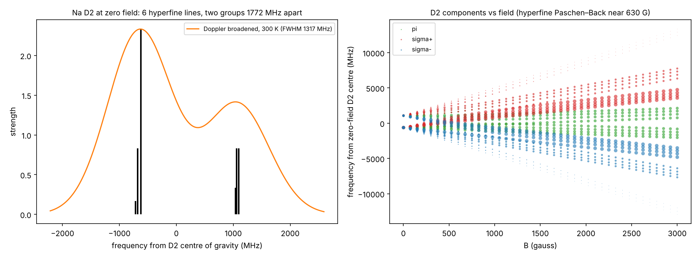
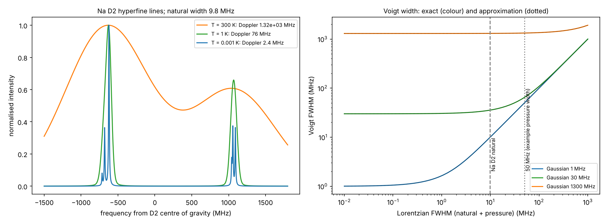
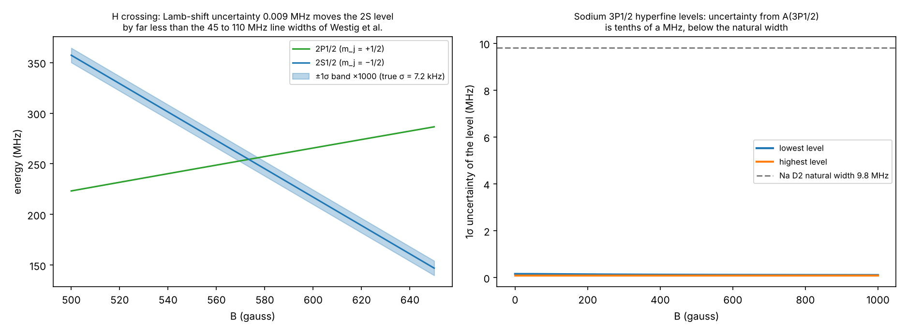
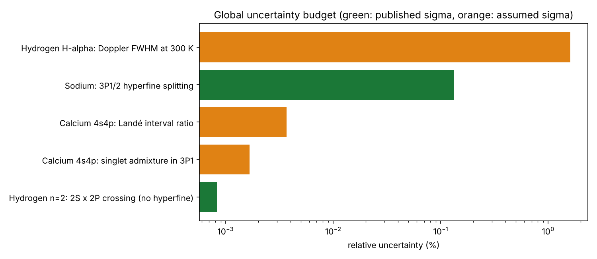

# Quantum Zeeman Engine

[](https://github.com/klinng/Quantum-Zeeman-Engine/actions/workflows/latex.yml)


**Take one big physics problem, split it into levels, and make every level checkable:**
a LaTeX derivation, a Python model, a plot or animation, and a comparison with measured values.
If the computed number reproduces the experiment, the model underneath is correct.

The case study is the **Zeeman effect** (how a magnetic field splits atomic energy levels). It grew from four levels of theory
into a small lab covering sodium, hydrogen, calcium, helium and mercury: real spectra, hyperfine structure, line shapes, a virtual
spectrometer with a prism and polarisation filters, an electric-field extension, a global uncertainty budget, and seven notebooks.

<p align="center">
  
</p>

## At a glance

What the model reproduces (every line is tested; see [Results](#results-all-reproduced-by-the-test-suite)):

- **Sodium D lines:** 4 + 6 Zeeman components, D2 : D1 = 2, D2 intensities 4 : 3 : 1 across the field, and the collapse towards the normal triplet above B* = 24.6 T.
- **g-factors:** the P-state values agree with the measured ones within 1σ. The S state is 2.3e-5 off because the model has no bound-state correction (a known, quantified limit).
- **Hyperfine:** the sodium ground splitting (1771.626 MHz) and the standard D2 strength fractions (1/20, 1/4, 7/10 and 1/6, 5/12, 5/12) come out of the model.
- **Hydrogen:** the 2S-2P crossing is at 573.4 G, which proton hyperfine splits into four (mean 571.6 G, against "about 570 G"; one of them, 605 G, matches a field quoted in the literature).
- **H-alpha:** deuterium is 178.6 pm bluer than hydrogen, the same as the measured rest wavelengths to 0.1 pm.
- **Hydrogen hyperfine:** the 2S interval is the newest measurement (177 556 838.87(85) Hz), and 8f(2S) − f(1S) = 48 959.2 Hz agrees with bound-state QED (48 954.1(2.3) Hz).
- **Helium:** calibrated to the six NIST n = 2 levels and the Kato et al. 2³P interval (a calibration, not a test; the exchange integrals and the inverted triplet with its broken Landé rule come out).
- **Mercury 546.1 nm:** the teaching-lab experiment is modelled (nine components, pressure-scanned Fabry-Perot); the analysis returns μB/hc within 1% of CODATA on a simulated recording. A real measurement is still to be added.
- **Uncertainty:** with published input uncertainties the error bands are far narrower than the lines, so the limit is what the model leaves out, not its inputs.

**How to read this repository.** In a hurry: look at the [Gallery](#gallery) and the Results tables. To use it: [Quick start](#quick-start) and [Use it from Python](#use-it-from-python). To learn or review the code: [`docs/CODE_GUIDE.md`](docs/CODE_GUIDE.md) explains every function. To check a number: the Sources section here and in the PDF.

## Contents

[At a glance](#at-a-glance) · [Quick start](#quick-start) · [What works for which atom](#what-works-for-which-atom) · [Gallery](#gallery) · [The levels and extensions](#the-levels-and-extensions) ·
[The model](#the-model) · [Results](#results-all-reproduced-by-the-test-suite) · [Sources](#sources) · [Limits and honesty notes](#limits-and-honesty-notes) ·
[Use it from Python](#use-it-from-python) · [Project layout](#project-layout) · [Roadmap](#roadmap) · [Credits](#credits)

## Quick start

```bash
git clone https://github.com/klinng/Quantum-Zeeman-Engine.git
cd Quantum-Zeeman-Engine
pip install -r requirements.txt
python scripts/run_all.py --fast     # tests, figures, notebooks, PDF (drop --fast to also render the GIFs)
python -m pytest -q                  # 279 tests (2 of them need PyTorch and skip without it)
```

Or only what you need: `python scripts/make_figures.py --gif`, `python scripts/make_optics_figures.py --gif`,
`python scripts/execute_notebooks.py`, `cd docs && latexmk -pdf main.tex`.
The full report is built from `docs/main.tex` (24 pages: derivations, results, symbols, sources and bibliography).

## What works for which atom

| System | Levels vs B | Line spectrum | Polarisation filters | Prism / instruments | Hyperfine | Line shapes | Uncertainty | Notebook | Report parts |
|---|:-:|:-:|:-:|:-:|:-:|:-:|:-:|:-:|---|
| **Sodium** (3p to 3s, D lines) | yes | yes | yes | yes | yes (levels and D lines) | Voigt | yes | 1 to 4, 6 | Levels 1 to 4, Extensions B, F, G, J |
| **Hydrogen n = 2** (Lamb shift, 2s and 2p) | yes, with crossings; electric field gives anticrossings and quenching | no (no jump between 2s and 2p) | no | no | yes (levels, four crossings near 573 G) | no | yes | 5 | Extensions A, D, F |
| **Hydrogen H-alpha** (n = 3 to 2, 656 nm) | yes | yes | yes | yes | no (no checked n = 3 constants; splittings far below the Doppler width) | Doppler only | yes (temperature sigma assumed) | 7 | Extensions C, H |
| **Calcium 4s4p** (two electrons: singlet and triplet P terms) | yes | not yet | not yet | not yet | none (Ca-40 has no nuclear spin) | no | yes (table precision only) | none yet | Extension E |

A spectrum needs a jump between two shells. That is why hydrogen n = 2 alone has levels but no light, and why H-alpha was added.

## Gallery

<p align="center">
  
</p>

*Sodium D lines at 1 T: 4 components for D1, 6 for D2, with polarisation (colour) and relative intensity (height).
Everything comes from diagonalising the Hamiltonian and applying the dipole operator.*

<p align="center">
  
</p>

*Hydrogen H-alpha at 0.05, 1 and 6 T. Rows: no filter, polariser parallel to B (keeps pi), polariser perpendicular to B (keeps sigma).
Grey is the 300 K Doppler width (8.1 pm). At 6 T the line has become the normal three-group Zeeman pattern.*

<p align="center">
  
</p>

*Which instrument can separate the H-alpha groups? A 5 cm glass prism needs 6 to 21 T, a 10 cm grating about 0.4 T. For hydrogen, thermal motion
(8.1 pm at 300 K) blurs the line so much that a Fabry-Perot gains nothing over the big grating: the Doppler floor is the limit, not the instrument.*

<p align="center">
  
</p>

*Hydrogen n = 2. The dotted line is the predicted 2S1/2 / 2P1/2 crossing at 573 G. A magnetic field never mixes 2s with 2p, so these levels cross instead of repelling.*

<p align="center">
  
</p>

*Electric field on hydrogen n = 2. Across B, the 573 G crossing opens into an anticrossing whose gap grows in proportion to E (the Lamb-Retherford effect).
Along B, 2S and 2P with the same m_j repel, and the metastable 2S state is quenched from 0.12 s towards nanoseconds (figure `hydrogen_stark_fan.png`).*

### The virtual spectrometer: colours, a prism, polarisation filters

<p align="center">
  
</p>

*Sodium D lines at 2 T. Across the field a polariser parallel to B keeps only the pi lines and a perpendicular one keeps only sigma.
Along the field there is no pi light, and a circular analyser separates sigma+ (red) from sigma- (green).*

| Animation | What it shows |
|---|---|
|  | **Colour filter sweeping the spectrum**: only the lamp lines inside the pass band reach the prism screen |
|  | **Rotating polariser** (Malus's law): pi and sigma lines trade places |
|  | **Tilting the line of sight**: pi fades out, sigma becomes circular |
|  | **Field ramp**: the Zeeman components of Na D1 and D2 fan out |
|  | **Level diagram with arrows** (Grotrian): one arrow per allowed transition, colour = polarisation, width = intensity; spin-flip arrows fade as B grows to 60 T |
|  | **Sodium D lines up to 60 T**: two anomalous patterns collapse towards the normal Zeeman triplet (above B* = 24.6 T the field beats spin-orbit coupling) |
|  | **Hydrogen H-alpha field ramp**: through no filter, a parallel and a perpendicular polariser, from weak field to Paschen-Back |

<p align="center">
  
</p>

*The same lines drawn as a level diagram. Levels sit at M = m_l + m_s (always conserved), arrows exist only where the transition is allowed, and at 60 T only 6 of the 10 arrows stay strong.*

**An honest scale note.** The outermost sodium D2 component moves only about 27 pm per tesla, and every component is the same yellow.
A prism cannot separate them: the closest components need a resolving power of about 55 000 at 1 T, while a 5 cm glass prism offers about 2 000.

<p align="center">
  
</p>

**The instrument that can.** A Fabry-Perot etalon (5 mm gap, finesse 30) turns each wavelength into a ring. At 0.3 T the sodium D2 ring splits
into six: two pi (blue) and four sigma (red and green), with peak heights close to the classic 4 : 3 : 1. A perpendicular polariser removes the pi pair.

<p align="center">
  
</p>
<p align="center">
  
</p>

**Strong field.** Above B* = ζ/μ_B ≈ 24.6 T the field overpowers the spin-orbit coupling and the sodium D doublet collapses towards the normal Zeeman
triplet. D1 and D2 lines cross over, so shifts are measured from the doublet's centre of gravity. A built-in check: the intensity-weighted mean σ shift is
±16.2 pm/T at every field from 1 to 120 T, whatever the pattern looks like.

<p align="center">
  
</p>

**Checked against a published calculation.** At 0.9 T the five sodium line-group spacings of the model agree with those of arXiv:2104.14896
(a theory study that includes hyperfine structure) to within 0.5 %. That is agreement with another calculation, not with laboratory data.

<p align="center">
  
</p>

### Beyond the Zeeman effect

<p align="center">
  
</p>

*Sodium D2 with the nuclear spin included: six lines at zero field with the standard strength fractions (1/20, 1/4, 7/10 and 1/6, 5/12, 5/12), blurred into two humps by the 1.3 GHz Doppler width at 300 K.*

<p align="center">
  
</p>

*Doppler, natural and pressure broadening as Voigt profiles: the six hyperfine lines separate only when the gas is cold.*

<p align="center">
  
</p>

*Error bands from the published input uncertainties are far narrower than the spectral lines, so the limit is the model, not the inputs.*

<p align="center">
  
</p>

*The global uncertainty budget: every observable of every system, coloured by whether its uncertainty is published or assumed.*

## Why decompose a problem?

1. **Understand** the phenomenon, the math and the physics behind it, one layer at a time.
2. **Verify** each layer against known results before adding the next, so errors can't hide.
3. **Compute, plot, animate** and run numerical experiments on a model you trust.

## The levels and extensions

| Part | Physics | Key result | Code | Report |
|---|---|---|---|---|
| Level 1 | Normal Zeeman (orbital only) | ΔE = μ_B B m_l, Lorentz triplet | `hamiltonians.h_zeeman` | `level_1_normal.tex` |
| Level 2 | Spin-orbit coupling, Landé g | ΔE = g_J μ_B B m_j | `hamiltonians.landé_g`, `h_spin_orbit` | `level_2_anomalous.tex` |
| Level 3 | Paschen-Back (strong field) | E ≈ μ_B B (m_l + g_s m_s) + ζ m_l m_s | `solvers.track_levels` | `level_3_paschen_back.tex` |
| Level 4 | Wigner-Eckart, selection rules, intensities, fitting | full line spectrum with polarisation | `transitions.py`, `fitting.py` | `level_4_tensors.tex` |
| Extension A | Hydrogen n = 2: Lamb shift, 2S-2P crossing | 573.4 G, against "about 570 G" in the literature | `hydrogen.py` | `ext_hydrogen_n2.tex` |
| Extension B | Colours, prism, polarisation filters, instrument ladder, Fabry-Perot, Paschen-Back to 60 T, Grotrian diagram, literature cross-check | required resolving power about 55 000 at 1 T; group spacings within 0.5 % of a published calculation | `src/optics/`, `literature.py` | `ext_optics.tex`, `ext_literature.tex` |
| Extension C | Hydrogen H-alpha (n = 3 to 2): radial integrals, Dirac fine structure, instrument ladder with the Doppler floor | spectrum from weak field to Paschen-Back | `hydrogen_spectrum.py` | `ext_hydrogen_halpha.tex` |
| Extension D | Electric field on hydrogen n = 2: Stark mixing, Lamb-Retherford anticrossing, 2S quenching | gap = 2√3 e a₀ E at 573 G | `stark.py` | `ext_hydrogen_stark.tex` |
| Extension E | Two valence electrons (calcium 4s4p): exchange splitting, spin-orbit mixing of singlet and triplet | Landé interval rule to 0.09 cm⁻¹; singlet admixture 7.8e-5 | `two_electron.py` | `ext_two_electron.tex` |
| Extension F | Nuclear spin: hyperfine structure of sodium and hydrogen n = 2; sodium D lines with hyperfine | Na 3S splitting 1771.626 MHz; D2 strengths 1/20, 1/4, 7/10; 573 G crossing splits into four (mean 571.6 G) | `hyperfine.py`, `hyperfine_lines.py` | `ext_hyperfine.tex` |
| Extension G | Line shapes: Doppler, natural and pressure widths as Voigt profiles | Na D2 natural width 9.80 MHz; hyperfine resolved only when cold | `line_profiles.py` | `ext_voigt.tex` |
| Extension H | Small corrections: diamagnetic term, H/D isotope shift | H-alpha diamagnetic shift 9.7 pm at 60 T; D bluer than H by 178.6 pm (measured: 178.6) | `diamagnetic.py`, `isotope.py` | `ext_corrections.tex` |
| Extension I | Photon operators a, a† and the Jaynes-Cummings atom-in-a-cavity demo | vacuum Rabi cos²(g t) and splitting g√N reproduced exactly | `cavity.py` | `ext_cavity.tex` |
| Extension J | Uncertainty: Monte Carlo and derivative propagation, z-scores, error bands, global budget | sampled σ equals exact σ (Na 3P₁/₂: 0.26 MHz); g_J(3S₁/₂) differs from measurement by 2.3e-5 | `uncertainty.py`, `uncertainty_bands.py`, `budget.py` | `ext_uncertainty.tex` |
| Extension K | Calcium Zeeman line spectrum 4s² ¹S₀ → 4s4p: 657 nm intercombination line, field-induced ³P₀ line | ³P₁ strength = 3ε² (ε² = 7.8e-5); ³P₀ strength ∝ B² | `calcium_lines.py` | `ext_calcium_lines.tex` |
| Extension L | Helium 1s2s and 1s2p: exchange from Slater integrals (G¹, G⁰), spin-orbit, spin-spin tensor, Zeeman | exchange splits singlet from triplet by 2G; spin-spin gives 1 : −5 : 10 over ³P₂,₁,₀ and breaks the Landé rule; calibrated to the six NIST n = 2 levels and the Kato et al. interval (6 parameters, 6 levels: a calibration) | `helium.py`, `helium_data.py` | `ext_helium.tex` |
| Extension M | Differentiable Voigt profile and Zeeman spectrum (Weideman Faddeeva function; gradients in B, T, P with PyTorch) | NumPy side equals scipy to 4e-14; the PyTorch tests skip when torch is absent | `torch_voigt.py` | `ext_differentiable.tex` |
| Extension N | Mercury 546.1 nm teaching-lab experiment: nine Zeeman components, pressure-scanned Fabry-Perot, the handout's analysis of μB/hc | simulated recording analysed with the handout's formula returns μB/hc within 2e-3; no real recording yet | `mercury.py` | `ext_mercury.tex` |

The report also contains a **Symbols and conventions** table (start) and a **Sources** section with the bibliography (end).
Every part has a test file; notebooks 1 to 7 show the same ideas with explanations and saved output.

## The model

For one electron with orbital momentum $l$ and spin $1/2$:

$$H = H_0 + \zeta\,\mathbf{L}\cdot\mathbf{S} + \mu_B B\,(g_l L_z + g_s S_z)$$

It is built as a matrix in the basis $|l, m_l\rangle \otimes |\tfrac12, m_s\rangle$ and diagonalised with `numpy.linalg.eigh`.
For sodium, ζ is fixed once from the measured 3p fine-structure splitting (17.196 cm⁻¹); everything else is a prediction.
Transition intensities use the Wigner-Eckart theorem: dipole matrix elements are 3-j symbols projected onto the exact eigenvectors.
For hydrogen, each shell is block-diagonal in $l$, Dirac energies fix the fine structure, and the radial dipole integrals come from the wavefunctions.

## Results (all reproduced by the test suite)

### Sodium

| Quantity | Model | Reference | Note |
|---|---|---|---|
| 3p fine-structure splitting | 17.196 cm⁻¹ | 17.196 cm⁻¹ | input, used to set ζ |
| g_J (²P₁/₂) | 0.6659 | 2/3 = 0.6667 | difference is g_s = 2.0023 instead of 2 |
| g_J (²P₃/₂) | 1.3341 | 4/3 = 1.3333 | same reason |
| g_J (²P₁/₂), (²P₃/₂) vs measured | 0.66589, 1.33411 | 0.66581(12), 1.3342(2) | within 1σ; values from Steck's Sodium D Line Data |
| g_J (²S₁/₂) vs measured | 2.0023193 | 2.0022960(7) | model lacks the bound-state correction (2.3e-5); a known limit |
| D1 / D2 Zeeman components | 4 / 6 | 4 / 6 | textbook pattern |
| D2 : D1 intensity ratio | 2.000 | 2 | statistical weights 4 : 2 |
| D1 components across B | 4 equal | 4 equal | classic result |
| D2 components across B (pi : inner sigma : outer sigma) | 4.00 : 2.99 : 1.00 | 4 : 3 : 1 | classic result |
| ζ recovered from synthetic data (1 µeV noise) | about 0.01 % error | known input | `fitting.py`, notebook 4 |
| D1 / D2 group spacings at 0.9 T (5 groups) | within 0.5 % | arXiv:2104.14896 (published theory, includes hyperfine) | `literature.py`; agreement with another calculation, not laboratory data |
| Ca 4s4p ³P₁ lifetime (intercombination line, 657 nm) | 0.22 ms | 0.39 ms (410 Hz) and 0.42 ms (375 Hz) in two papers | order of magnitude only (factor 1.8 to 1.9); ¹P₁ rate 2.20e8 from the NIST Handbook |
| Ca 4s4p ³P₁ energy | 15210.0638 cm⁻¹ (used as input) | 455 986 240 494 135.8 Hz measured, divided by c | verified from [a frequency measurement](https://tf.nist.gov/general/pdf/2197.pdf) |
| Ca 4s4p Landé interval rule (³P₂−³P₁ : ³P₁−³P₀) | holds to 0.09 cm⁻¹ | 2 : 1 | term energies from the NIST Handbook (see Sources) |
| Resolving power to separate components at 1 T | about 55 000 | prism 2 000, grating 1.2×10⁵ | a prism cannot show the pattern |

### Hydrogen

| Quantity | Model | Reference | Note |
|---|---|---|---|
| 2S × 2P crossing near 573 G, no hyperfine | 573.4 G | "about 570 G" (Westig et al., arXiv:1104.4421, introduction) | single crossing |
| Same crossing with proton hyperfine | four crossings at 538.1, 552.2, 591.0, 605.0 G; mean 571.6 G | spin-filter fields quoted in the same paper (Fig. 2 caption): 535 G and 605 G for H-alpha | 605 G matches; the lowest differs by 3 G (535 against 538.1), not explained: the quoted fields are selection settings, possibly rounded. The mean is close to "about 570 G" |
| H 2P₁/₂ hyperfine splitting | 59.2212 MHz (input) | theory 59221.2 kHz and measured 60(2) MHz, same paper | the measurement is too coarse to test the model; Lamb shift there 1057(1) MHz agrees with the value used |
| H 2S hyperfine splitting | 177.55683887 MHz | 177 556 838.87(85) Hz, measured (Phys. Rev. Lett. 130, 203001) | an input, not a prediction; the combination 8f(2S) − f(1S) = 48 959.2 Hz agrees with bound-state QED, 48 954.1(2.3) Hz, within 1σ of the combined uncertainty |
| Na 3S₁/₂ hyperfine splitting | 1771.6261 MHz | Steck table | an input (A), reproduced as 2A |
| Na D2 hyperfine line strengths | 1/20, 1/4, 7/10 (F=2) and 1/6, 5/12, 5/12 (F=1) | standard angular-momentum (Racah) values | not an input: the model produces them from the dipole matrices |
| 2P₃/₂ − 2P₁/₂ (Dirac vs measured) | 10949 MHz | 10969.13(10) MHz (Baird et al. 1972) | 0.2 % apart (QED) |
| ⟨2p\|r\|1s⟩ | 1.290266 a₀ | 128√6/243 a₀ | exact |
| A(2p to 1s), A(3p to 2s), A(3d to 2p), A(3s to 2p) | 6.2649e8, 2.2448e7, 6.4651e7, 6.3136e6 s⁻¹ (reduced-mass radial scale, A ∝ μ) | 6.2649e8, 2.2448e7, 6.4651e7, 6.3143e6 s⁻¹ (Wiese and Fuhr 2009, Table 6, finite-mass convention) | within 1.1e-4; the residual is the relativistic part of the tabulated values |
| A(2p to 1s) closed form | 6.26490e8 s⁻¹ | (2/3)⁸ α⁵ mₑc²/ħ × μ/mₑ = 6.26831e8 × 0.999456 | exact algebra, no quadrature |
| H/D shift of H-alpha (D minus H) | −178.6 pm (reduced mass only) | −1.786 Å from rest wavelengths 6562.796 and 6561.010 Å (air), i.e. −81.6 km/s (Hébrard et al., arXiv:astro-ph/0002141) | agrees to 0.1 pm |
| H-alpha sigma shift at 20 T | 402.27 pm | 20.11 pm/T × B = 402.20 pm | normal Zeeman limit |
| 2S Stark shift at 10 V/cm (E along B) | 0.3650 MHz | 0.3652 MHz | second-order perturbation theory |
| Anticrossing gap at 573 G | 4.54 MHz per V/cm | 2√3 e a₀ = 4.43 MHz per V/cm | 2.5 % apart (mixing with 2P₃/₂) |
| H-alpha thermal Doppler width, 300 K | 8.1 pm | 8.1 pm | compare with 20.1 pm/T Zeeman shift |

Reference values live in `data/experimental_reference.csv`.

## Sources

Full list with values, status and the bibliography: the "Sources" section of `docs/main.pdf` (also `data/experimental_reference.csv`).

| Input | Source |
|---|---|
| Physical constants | CODATA via `scipy.constants` |
| Sodium hyperfine constants, g_I, measured g_J | D. A. Steck, *Sodium D Line Data* (steck.us/alkalidata) |
| Sodium 3p levels 16956.172 and 16973.368 cm⁻¹ (interval 17.196 cm⁻¹); D-line decay rates 0.616e8 and 0.614e8 s⁻¹ | NIST Handbook of Basic Atomic Spectroscopic Data, Na I tables (MZ81, M03) |
| Sodium group-spacing cross-check | arXiv:2104.14896 (published theory) |
| H Lamb shift 1057.845(9) MHz | Lundeen and Pipkin, as quoted in arXiv:0809.2985 |
| H 2P₃/₂ − 2P₁/₂ = 10969.13(10) MHz | Baird, Brandenberger, Gondaira, Metcalf, Phys. Rev. A 5, 564 (1972) |
| H 2S hyperfine 177 556 838.87(85) Hz | Phys. Rev. Lett. 130, 203001 (abstract) |
| H 1S Fermi value 1420.405751768 MHz | arXiv:physics/0608192 |
| H crossings near 570 G; H 2P₁/₂ hyperfine theory value 59.2212 MHz | M. P. Westig et al., "Hydrogen spectroscopy with a Lamb-shift polarimeter", Eur. Phys. J. D (2010), arXiv:1104.4421 |
| H decay-rate checks | Wiese and Fuhr, J. Phys. Chem. Ref. Data 38, 565 (2009), Table 6 |
| H 2S two-photon decay 8.2206 s⁻¹ (theory) | Labzowsky et al. 2005, quoted in arXiv:1711.05533 |
| H/D isotope shift of H-alpha | G. Hébrard, D. Péquignot, A. Vidal-Madjar, J. R. Walsh, R. Ferlet, arXiv:astro-ph/0002141 |
| Ca 4s4p energies and ¹P₁ decay rate | NIST Handbook of Basic Atomic Spectroscopic Data, Ca I tables (SC85, M03) |
| Ca ³P₁ energy | measured frequency 455 986 240 494 135.8(3.4) Hz, tf.nist.gov/general/pdf/2197.pdf |
| Glass dispersion | Sellmeier coefficients from the Schott catalogue |
| Zeeman and Paschen-Back theory | standard quantum mechanics texts and the UCSD PH130A notes |

Every figure is drawn by this repository's code from the inputs above. Not checked against a source: the hydrogen 2P₃/₂ hyperfine
constant (leading-order theory, Fermi/60).

## Limits and honesty notes

**Inputs and uncertainties**
- Every σ in `budget.py` is labelled *measured* or *assumed*. Published σ exist for the sodium hyperfine constant and the hydrogen Lamb shift. Calcium energies carry only the NIST table's precision, and the H-alpha temperature σ is an assumption.
- With published input uncertainties, the error bands are far narrower than the spectral lines: the limit on agreement is the model, not the input numbers.
- The sodium g_J(3S₁/₂) row differs from the measurement by 2.3e-5 because the model uses the free-electron g_s and has no bound-state correction.

**Not modelled**
- Helium is modelled (Extension L) with effective spin-spin and spin-other-orbit parameters, calibrated to NIST levels (`helium_data.py`); electron-electron effects beyond the two-electron s-p model, and the sodium electric-quadrupole term (2.7 MHz).
- Hyperfine in the H-alpha spectrum: no checked n = 3 constants, and the splittings are far below the 7 GHz Doppler width.
- Pressure broadening has no built-in collision coefficient: the width is an input you choose.
- The diamagnetic term is estimated (`diamagnetic.py`), not added to the Hamiltonians: for H-alpha the largest shift is 1.1 pm at 20 T and 9.7 pm at 60 T, below 1 % of the Zeeman shift but comparable to the 8.1 pm Doppler width at 60 T.

**Approximations**
- The n = 3 Lamb shift is the measured n = 2 value scaled as 1/n³.
- The isotope shift uses the reduced mass only (no finite nuclear size); it agrees with the measured H-alpha / D-alpha rest wavelengths to 0.1 pm.
- Hydrogen 2P₃/₂ and n = 3 hyperfine use a leading-order formula (`hydrogen_hfs_leading_mhz`, theory; it reproduces 2S to 4e-5 and 2P₁/₂ to 9e-4, but is not a published table).

**Provenance and testing**
- `src/optics/` (colour, prism, polarisation, spectrometer, figures) was written earlier in this project by the repository owner. It computes every spectrum from this repository's own Hamiltonians and dipole matrices and imports only numpy, scipy, pandas and matplotlib. The later extensions added `instruments.py`, the H-alpha figures and the Grotrian diagram; the older modules deserve a review before being relied on.
- The PyTorch half of `torch_voigt.py` was run by the repository owner (PyTorch 2.15, Windows, Python 3.11): all 237 tests of that date passed. It was not run in the development sandbox, and `torch_engine.py` has no dedicated test.

## Use it from Python

```python
import numpy as np
from src.validation import zeta_from_fine_structure
from src.solvers import track_levels
from src.hydrogen_spectrum import balmer_components
from src.optics.spectrometer import observe
from src.optics.polarization import linear_polariser
from src.hyperfine_lines import sodium_d_hyperfine_lines, group_lines
from src.uncertainty import monte_carlo, sigma_compare
from src.uncertainty import sodium_3p12_splitting_mhz

zeta = zeta_from_fine_structure(17.196, l=1)               # eV, from sodium
levels = track_levels(1, np.linspace(0, 100, 200), zeta)   # shape (200, 6), eV

halpha = balmer_components(1.0)                            # hydrogen H-alpha at 1 T
seen = observe(halpha, 90.0, linear_polariser(0.0))        # across the field, polariser parallel to B
print(seen[seen.observed > 1e-3][["polarisation", "shift_pm", "observed"]])

d2 = group_lines(sodium_d_hyperfine_lines(0.0), "D2")      # six hyperfine lines of sodium D2 at zero field
r = monte_carlo(sodium_3p12_splitting_mhz, {"a_3p12": (94.44, 0.13)}, n=200)
print(r["mean"], r["std"])                                 # 188.9 +- 0.26 MHz
```

## Project layout

```
src/            constants, hamiltonians, solvers, transitions, fitting, validation, animation
                hydrogen, hydrogen_spectrum, stark, stark_figures          (hydrogen)
                two_electron, two_electron_figures                         (calcium)
                hyperfine, hyperfine_lines, hyperfine_figures              (nuclear spin)
                line_profiles, diamagnetic, isotope, corrections_figures   (line shapes, small corrections)
                calcium_lines                                              (calcium line spectrum)
                helium, helium_data, mercury, torch_voigt                                        (helium, differentiable spectrum)
                cavity                                                     (photon operators, Jaynes-Cummings)
                uncertainty, uncertainty_bands, uncertainty_figures, budget (uncertainty)
                literature, torch_engine
src/optics/     color, prism, polarization, spectrometer, instruments, grotrian, fabry_perot,
                sodium_paschen_back, halpha_instruments, figures, hydrogen_figures
tests/          279 tests (2 need PyTorch), one file per module: algebra, Landé g, Paschen-Back, selection rules, sodium D lines, fitting,
                hydrogen, H-alpha, Stark effect, two-electron atom, hyperfine, line shapes, corrections, cavity, uncertainty,
                literature check, Fabry-Perot, optics
data/           experimental reference values, mercury TP template and simulated example
CITATION.cff    citation metadata for the GitHub "Cite this repository" button; mercury TP template and simulated example
notebooks/      seven labs (levels 1 to 4, hydrogen n=2, virtual spectrometer, H-alpha), with explanations and saved output
docs/           LaTeX report (main.tex + one file per part), figures, and CODE_GUIDE.md
scripts/        run_all.py, make_figures.py, make_optics_figures.py, make_notebooks.py, execute_notebooks.py
.github/        CI: tests, notebook execution and PDF build on every push
```

New to the code? Read [`docs/CODE_GUIDE.md`](docs/CODE_GUIDE.md): it explains every script and function.

## Roadmap

Done:
- [x] Levels 1 to 4: Zeeman physics, spectra, selection rules, fitting
- [x] Hydrogen n = 2 (2s and 2p together, Lamb shift) and H-alpha (a real hydrogen spectrum with polarisation filters, field-ramp animation, prism and instrument ladder with the Doppler floor)
- [x] Virtual spectrometer: colours, prism, polarisation filters, Fabry-Perot rings, Paschen-Back collapse to 60 T, Grotrian level diagram
- [x] Electric field on hydrogen n = 2 (Lamb-Retherford quenching, anticrossings)
- [x] Two-electron system with LS-coupling mixing (calcium 4s4p levels from the NIST Handbook) and its Zeeman line spectrum, including the field-induced 3P0 line
- [x] Cross-check of sodium line-group spacings against a published calculation (arXiv:2104.14896)
- [x] Hyperfine structure for sodium and hydrogen n = 2; sodium D lines with hyperfine; hydrogen crossings compared with arXiv:1104.4421
- [x] Voigt line profiles (Doppler, natural; pressure width as an input)
- [x] Diamagnetic estimate and H/D isotope shift (reduced mass, checked against measured rest wavelengths)
- [x] Photon operators and the Jaynes-Cummings demo (stand-alone)
- [x] Uncertainty propagation, z-scores, error bands, global budget
- [x] Symbols table, sources section and bibliography in the report

Open, and what each needs from outside (if you can supply any of these, the item can be closed):
- [x] Helium 1s2s/1s2p Hamiltonian with Slater-integral exchange, spin-orbit and spin-spin (Extension L).
- [x] Helium model calibrated to the NIST Handbook levels and the Kato et al. 2³P interval (a calibration, not a test).
- [ ] **Independent helium test:** a measured helium Zeeman splitting or g-factor (not used in the calibration) to compare with the predicted fan.
- [x] Hydrogen 2P₃/₂ and n = 3 hyperfine: leading-order formula implemented (theory, tested against 2S and 2P₁/₂).
- [ ] **Published n = 3 hyperfine table** to cross-check the formula, then add hyperfine to the H-alpha spectrum.
- [ ] **Laboratory Zeeman spectra:** compare full spectra with measurements (the arXiv:2104.14896 paper is theory; look for experimental companions).
- [x] Differentiable Voigt profile and Zeeman spectrum written (NumPy side tested).
- [x] PyTorch tests run and pass (gradcheck; gradients in B, T and P against finite differences).

## How to cite

GitHub's "Cite this repository" button uses `CITATION.cff`. Please also cite the sources of the inputs you use (see [Sources](#sources) and the bibliography in the PDF).

## Credits

Developed by Mahdi Ben Miled with the assistance of Claude (Anthropic); commits carry a co-author line. Every number is tested or traced to a source (see Sources).

## License

MIT. See `LICENSE`.
